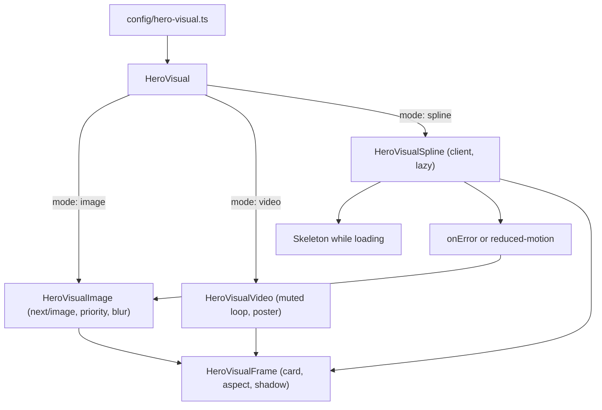

# Minimal Premium Portfolio Redesign

Replace the Once UI "Magic Portfolio" template with an original, minimal-premium personal-brand
site on Next.js App Router + Tailwind v4, built around central TypeScript data files, a swappable
`HeroVisual` abstraction that is Spline-ready, and full SEO.

- **Branch:** `redesign/personal-brand` (cut from `origin/development`, not to be merged into `development`)
- **Audience:** Senior Full-Stack Software Engineer and tech-startup founder
- **Accent color:** cobalt `#2447F0` (single accent, nothing else)

## Task checklist

- [ ] **Toolchain** — `globals.css` design tokens + blueprint grid + reveal utilities, Inter/JetBrains Mono fonts, new root layout
- [ ] **Data layer** — `src/data/*` (site, profile, social, experience, skills, tools, projects), `src/config/hero-visual.ts`, `src/lib/notes.ts`; seed from existing `content.js`
- [ ] **Shell** — UI primitives, pill nav header, footer, floating social rail, skip link, `Reveal` motion wrapper
- [ ] **Hero visual** — frame + image/video/lazy-Spline renderers with loading, error, and reduced-motion fallbacks
- [ ] **Pages** — Home, Work + case studies, Experience, Skills & Tools, Notes + MDX posts, Contact + validated API route
- [ ] **SEO** — seo helper, per-page metadata, Inter-embedded OG route, sitemap, robots, JSON-LD structured data
- [ ] **Cleanup** — delete once-ui and legacy template code/routes/assets, rewrite README, verify tsc + build + browser/a11y pass

## Starting state

Four uncommitted setup changes already exist on the branch: pruned Once UI dependencies in
`package.json`, Tailwind v4 wiring in `postcss.config.js`, old-route redirects in `next.config.mjs`,
and the generated hero render in `public/images/hero/` (PNG + 45 KB WebP + blur placeholder).

The tree does not build at this point: removing `sass` and the Once UI chain left roughly 20 files in
`src/components/` and `src/app/` importing `.scss` and `@/once-ui`. Those files are all slated for
deletion, so the build returns to green at the end of the Pages step.

Confirmed decisions:

- Accent is cobalt `#2447F0`.
- Contact form is an API route with server-side validation plus a working `mailto:` fallback.
- Current role and founder venture are added as clearly-labeled placeholders, since the real
  experience data stops at April 2025 and employment history must not be fabricated.

## Design system

Tokens live in `src/app/globals.css` using the Tailwind v4 `@theme` block, so they are usable as
`bg-bg`, `text-muted`, `border-line`, `text-accent`:

```css
@import "tailwindcss";
@theme {
  --color-bg: #f7f7f8;        /* off-white page */
  --color-surface: #ffffff;   /* cards */
  --color-ink: #0a0a0b;       /* headings */
  --color-muted: #52525b;     /* charcoal body copy */
  --color-line: #e5e5e8;      /* hairline borders */
  --color-accent: #2447f0;    /* cobalt, the only accent */
  --font-sans: var(--font-inter);
  --font-mono: var(--font-mono);
  --shadow-soft: 0 1px 2px rgb(10 10 11 / 0.04), 0 8px 24px -12px rgb(10 10 11 / 0.10);
}
```

Plus a `.bg-blueprint` utility (a `radial-gradient` dot grid at roughly 1px per 24px, masked to fade
at section edges), a `.reveal` transition pair driven by `IntersectionObserver`, and a global
`@media (prefers-reduced-motion: reduce)` block that disables all transforms and transitions.

Adapted from the reference screenshots without copying layout, content, or wording: full-width
rounded pill nav with a solid black active pill, oversized tight-tracked black headings, muted gray
supporting copy, pill proof-point chips mixing filled and outlined styles, pill CTAs, centered
section headers with a short accent rule, a left-edge vertical social rail on desktop, and visuals
housed in soft rounded cards. Fonts are Inter and JetBrains Mono via `next/font/google`, replacing
the template's Geist.

## Central data layer

All editable content lives in `src/data/` as typed TypeScript, seeded from the real content in
`src/app/resources/content.js`:

- `site.ts` — real base URL, site name, nav items, default metadata
- `profile.ts` — name, role, positioning statement ("Building scalable software products and useful
  tools."), bio, avatar, availability status, proof points
- `social.ts` — LinkedIn, GitHub, Facebook, Instagram, email; drives both the footer and the
  floating social rail
- `experience.ts` — the 4 real roles with their measurable impact, education, plus `TODO` placeholder
  entries for the current role and founder venture
- `skills.ts` — grouped frontend / backend / cloud / databases / architecture / AI / leadership, no
  percentage bars, icons mapped to the existing `public/images/logo/*.svg` files
- `tools.ts` — free tools, open-source projects, community experiments
- `projects.ts` — the single source for both the Work grid and the case studies; each entry carries
  `slug`, `category` for filtering, `summary`, and the case-study fields required by the brief:
  `problem`, `contribution`, `stack`, `outcome`, `screenshots`, `links`

Articles stay as MDX in `src/content/notes/*.mdx` with frontmatter, read by a new `src/lib/notes.ts`.
This replaces `src/app/utils/utils.ts`, whose `getPosts` wrongly calls `notFound()` from inside a data
helper. Existing template `.mdx` files are removed and three polished placeholder articles written.

## HeroVisual architecture

Every 3D and visual setting lives in one file, `src/config/hero-visual.ts`, keyed so that different
pages or projects can later opt into different visuals:

```ts
export type HeroVisualMode = "image" | "video" | "spline";

export const heroVisual = {
  mode: "image",                       // flip to "spline" later, nothing else changes
  image: { src: "/images/hero/hero-visual.webp", alt: "...", width: 1200, height: 1200 },
  video: { src: null, poster: "/images/hero/hero-visual.webp" },
  spline: { embedUrl: process.env.NEXT_PUBLIC_SPLINE_SCENE_URL ?? "" },
  frame: { aspect: "1 / 1", maxWidth: 560, card: true },
  motion: { float: true },
};

export const pageHeroVisuals: Partial<Record<string, Partial<typeof heroVisual>>> = {};
```

`HeroVisual` is a server component that reads the config and picks a renderer. Page layout and copy
never touch it.



Spline mode uses a lazily-mounted `<iframe>` embed, so no 3D package is installed and nothing ships
to the client until `mode` is changed. It mounts only after `IntersectionObserver` fires, shows a
skeleton while loading, and falls back to the static image on error or when reduced motion is
requested. The README documents the one-file swap to `@splinetool/react-spline` or React Three Fiber
for anyone who wants the full runtime.

## Components

- `src/components/ui/` — `Container`, `Section` (eyebrow + heading + accent rule), `Button` (pill;
  solid/outline/ghost), `Card`, `Tag`, `Pill`, `Prose`, `Reveal`
- `src/components/layout/` — `SiteHeader` (client: pill nav, active-route black pill, mobile sheet),
  `SiteFooter`, `SocialRail` (fixed left, desktop only, labelled for screen readers), `SkipLink`
- `src/components/hero/` — `Hero`, `HeroVisual`, `HeroVisualFrame`, `HeroVisualImage`,
  `HeroVisualVideo`, `HeroVisualSpline`
- `src/components/work/` — `ProjectCard`, `ProjectFilter` (client; filter state reflected in the URL
  query so filtered views are shareable)
- `src/components/notes/` — `NoteCard`, `MdxContent` (Tailwind-styled `next-mdx-remote/rsc`
  components; replaces the Once UI-dependent `src/components/mdx.tsx`)
- `src/components/contact/ContactForm.tsx` — client; accessible labels, inline validation,
  success and error states

## Pages

1. `/` — hero (split layout, headline + positioning statement + View Work / Contact Me CTAs +
   proof-point chips), short introduction, selected projects, experience snapshot, skills snapshot,
   latest notes, social links
2. `/work` — filterable project grid from `projects.ts`; `/work/[slug]` renders problem,
   contribution, stack, outcome, screenshots, and links via `generateStaticParams`
3. `/experience` — career timeline with roles, companies, responsibilities, measurable impact, and
   education
4. `/skills` — grouped skill sections plus a separate free-tools / open-source / experiments section
5. `/notes` — article index; `/notes/[slug]` renders MDX with reading time and shareable metadata
6. `/contact` — availability status, contact form, `mailto:` fallback, social links

`src/app/api/contact/route.ts` validates and rate-limits submissions server-side and returns typed
JSON, with a clear `TODO` block showing exactly where to drop in Resend or a similar provider.

## SEO and accessibility

A `src/lib/seo.ts` helper builds per-page `Metadata` (title template, canonical, Open Graph,
Twitter). `src/app/og/route.tsx` is rewritten to the new light visual language and finally embeds the
already-present `public/fonts/Inter.ttf`. `sitemap.ts` and `robots.ts` are regenerated from `site.ts`
and the data files. `src/lib/structured-data.ts` emits JSON-LD for `Person`, `WebSite`,
`BreadcrumbList`, and `BlogPosting` on note pages. Throughout: semantic landmarks, visible focus
rings, AA contrast, keyboard-navigable nav and filters, and mobile-first breakpoints.

## Removals

Delete `src/once-ui/` entirely, all legacy components in `src/components/` (`Header`, `Footer`,
`ThemeToggle`, `Mailchimp`, `RouteGuard`, `about/`, `blog/`, `gallery/`, `portfolio/`, `project/`,
`work/`, and every `.module.scss`), legacy routes `src/app/{about,portfolio,gallery,blog,work,contact}/`,
the password-protection APIs `src/app/api/{authenticate,check-auth}/`, and `src/app/resources/` plus
`src/app/utils/`.

The gallery page is dropped since it is not part of the new six-page information architecture;
`/gallery` redirects to `/work`. Redirects for `/about`, `/portfolio`, `/blog`, and `/blog/:slug` are
already in `next.config.mjs`.

`public/` keeps the avatar, the tech logos, and `Inter.ttf`; unused template gallery and trademark
images are pruned.

## README

Rewritten to cover updating profile data, adding a project and case study, publishing an article,
changing social links, swapping the hero visual (including enabling Spline via
`NEXT_PUBLIC_SPLINE_SCENE_URL`), wiring the contact email provider, and deploying.

## Verification

`npx tsc --noEmit`, then `npm run build`, then `npm run dev` with a browser pass over all six routes
at mobile and desktop widths, checking keyboard tab order, reduced-motion behaviour, and that no
Spline or other 3D JavaScript appears in the initial bundle.
